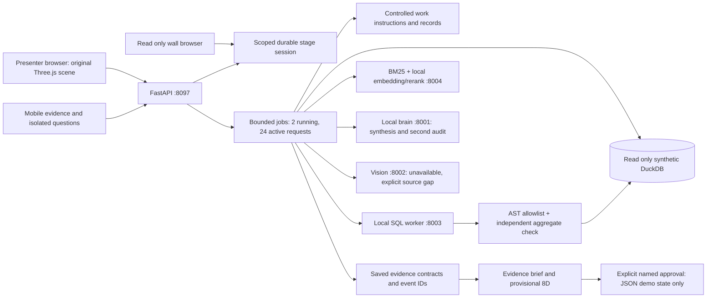

# Plant 7: Inside the Line architecture

This is a synthetic operational visualization with real local inference. It is not engineering CAD, a validated digital twin, a physics simulator, a production deployment or an autonomous safety system.

## Runtime boundary

The viewer's browser renders Three.js geometry and uPlot telemetry. HP ZGX Fury serves FastAPI, read only synthetic DuckDB records, local documents, clips and inference. There is no Omniverse, Unreal, Isaac Sim, headset, ray tracing server, FOX, Z Runtime or OpenShift dependency or tested integration. Existing inference containers retain their pinned settings, network-none isolation and project Unix sockets. The existing project proxy exposes model APIs on loopback only. The existing authorized app LAN binding and private Tailscale route are preserved; no firewall or network settings were changed.

## Incremental integration

Original FastAPI streaming investigation, clients, SQL sandbox, document/video ingestion, model configuration and model start/stop machinery remain. The original UI is retained at `/legacy`. New presentation routes are `/`, `/wall`, `/compute`, `/m`; `/health` is extended with actionable readiness. Existing `/api/investigate` remains the general tool loop. Existing mutating report, load test and interface-counter APIs now require the presenter header, matching the new control boundary.

New code is in `plant7/inside_line.py`, `frontend/main.ts`, `frontend/scene.ts`, and `frontend/geometry.ts`. The local TypeScript/esbuild build uses package-lock.json. Checked in output under `static/inside` supports launch without Node or internet. The scene chunk is dynamically imported only for desktop and wall routes; mobile does not request Three.js or instantiate a canvas.

## Evidence and scene identity

`Evidence` is a Pydantic contract with run ID, source ID, source type, unit ID, station ID, component ID, explicit source timestamps, extraction method, observed fact, optional inference and availability status. Source types distinguish telemetry, documents, maintenance, video, genealogy and quality. The model interpretation is separate from source facts.

`L3-S40-BRACKET-B7` is the fictional component. `B1` through `B4` map explicitly to `torque_results.bolt`, station `L3-S40`, and that component. Hotspots read the exact unit and bolt record rather than a generic description. The example unit is `P7-20261110-32-0021`. Its four tool source times are 14:42:41 through 14:42:44 UTC. Generated fixture timestamps are declared UTC in the source manifest; naive database strings are displayed with that declared basis.

The synthetic clip begins at 14:42:38 UTC. Its author animation is deliberately aligned to those stored timestamps. This is an authored clock, not a measured camera synchronization result. The half second nearest-sample UI lookup is a display tolerance, not a claim about sensor accuracy. At other times the UI shows a source gap. Angle and torque are not interpolated. No torque or clamp force is derived from video. Manually authored labels and socket motion are never detections or supplied as answers to the VLM.

## Investigation and trust boundaries

The focused stage workflow first reads real source queries, emits first useful evidence, retrieves controlled instructions/maintenance, asks the real local worker to draft a comparison SELECT, executes it in the existing SQL sandbox and independently compares its aggregates. Hybrid retrieval uses local embedding/rerank with visible degradation if unavailable. The brain synthesizes a bounded hypothesis and runs a second audit. Source IDs are constrained by the JSON output schema. Tool identity and no-signal checks use retrieved measurements, not scenario evaluation labels. Known unsupported causal wording fails the run. This structural and model audit is not a proof of semantic support; the presenter must inspect citations and uncertainty.

`query_mes` retains sqlglot statement, AST, table and function allowlists; read-only connections; disabled external access; two database threads; 1 GB query memory limit; five second interrupt; 1000 row cap. Alternate database paths come only from a code allowlist. No arbitrary SQL files, attachments, filesystem table functions, network SQL functions, shell execution or physical control are agent tools. Process-management code is operator tooling, not available to inference. Retrieved text is evidence, never instructions.

Counterfactual databases are created by `scripts/build_scenarios.py` without modifying the original MES. They cover normal measurements, the other tool, missing video, an intentionally occluded clip and an actual supplier signal across four lines. Alternate maintenance records supersede original incident notes. Incompatible raw original shift notes are excluded from stage model inputs. Source changes and limitations are explicit. Ground truth expectations exist in behavioral tests, not in model inputs.

## One cohort, one decision basis

The inspection cohort derives from observed tool signals bounded by recorded tool return and verification timestamps. The original dataset returns 539 unique units, including eight recorded angle exceptions, 536 shipped and three held. Existing held status is projected to finished goods for presentation; no physical location is asserted. No WIP units exist in this selected scope. A recorded angle nonconformance is separate from an unverified physical defect. The last verified good reference check before return remains unknown, so this is a conservative demonstrated scope rather than a complete validated containment boundary.

The supplier counterfactual has a broad lot population larger than the bounded UI policy. The displayed cohort explicitly narrows to the complete set of 16 recorded exception units across all four lines; broader lot genealogy remains unresolved. A truncated 1000-row sample is never shown as a full population.

Counts, unit marks, passports, hold drafts and exports use the same saved result. Preparing a draft does not apply it. Confirmation requires the literal simulation action and a named demo approver. It records exact unit IDs, reason, run ID, approval and unresolved checks. Approval is idempotent. Only `runtime/inside` JSON state changes; the MES is read only. No MES, PLC, robot, shipment or external-system write tools exist. D4 remains suspected; D5 through D8 remain pending without real validation.

## Sessions, recovery and replay

The guided UI creates an isolated browser session using `/api/stage/demo-session`. A random capability is returned only on creation and stored in browser sessionStorage; its SHA-256 digest is stored with that session and never returned by read APIs. It authorizes only that session's navigation, run selection, cancellation and simulated holds. It cannot operate another session or global legacy/load/counter controls. Creating a visitor session does not replace the machine's existing following-display session. Wall and mobile routes never acquire a control capability. Refresh restores the same browser session. Duplicated tabs with copied sessionStorage can intentionally share that existing session.

The original randomly generated local operator credential remains at `runtime/inside/presenter.key`, mode 0600, for operator tooling and legacy compatibility. It is not part of the guided UI. Session keys and the global key are excluded from release bundles. API responses carry no-store cache headers.

The single main action starts an investigation at Station 40, advances to automatically playing authored evidence, waits for an accepted result before showing scope/decision and resets at the end. Model or submission failures keep a usable retry path; recording requires a visible explicit choice. A model-free installation defaults to a labelled recording and rejects live stage submissions.

Jobs separate queued, running, completed, failed and canceled states, with a two-job execution semaphore, 24 active-request bound and per-client submission limits. Completed resident state is bounded; source traces remain on disk. Queue delay, first evidence, source query time, retrieval time, worker/model/audit latency and completion time are separate observations. Model token usage comes from actual server responses. Cancellation propagates to the local HTTP stream. Filesystem query threads retain the five second timeout. An interrupted job loaded after restart is marked failed, never completed.

SSE events have monotonically increasing IDs and support an `after` cursor and Last-Event-ID. Reconnecting does not create another job, replay tool work or reapply holds. Submission request IDs deduplicate a retry whose response was lost; reusing an ID for different input is rejected. A recorded recovery does not consume a live execution-queue slot. Explicit stage changes persist immediately with keepalive; cursor updates are bounded. Source inspection and stage navigation do not wait for inference.

The stage replay is a captured successful telemetry/document run, with its unavailable vision scope preserved. It is independent of the older all-three-source golden acceptance mechanism. Replay carries a persistent badge and recorded measurements. It never calls a model, appends live token usage or claims live completion. Reset clears only that session's simulated state and selection, preserving real source traces.

## Privacy evidence

NIC traffic is not used as a privacy claim. Compute displays local endpoint destinations, controlled offline workflow results and browser request audit. The isolated workflow test denies external sockets while retaining loopback; the browser test denies external destinations while exercising assets and actual APIs. Model containers remain network-none. These scoped checks are not an audited security guarantee. A tailnet viewer receives evidence remotely. A physical cable removal demo is documented only for a locally connected console, never an active remote session.

The preserved generic streaming endpoint also has a 24-request pending bound and per-client rate limit. Overflow is rejected before model work. Closing its streaming response releases the pending slot; the stage job API supplies explicit durable IDs and cancellation for the presentation workflow.

## Measured token economics and installation

`RUN_USAGE` uses an async context variable so overlapping jobs cannot mix token measurements. Generation-call input/output totals include the worker, synthesis, second audit and vision only if it actually ran. Embedding and reranking measurements remain inspectable but are excluded from the generation cost arithmetic. Historical recordings use their saved per-call measurements and carry a recorded basis. Missing usage stays unknown; incomplete usage disables cost extrapolation. Editable illustrative rates and investigation volume are arithmetic, not provider pricing or total cost of ownership.

The installer creates a project-local Python environment, validates package file checksums, restores synthetic fixtures, generates a launcher for the actual folder and records replay/live mode. It never changes drivers, Docker configuration, firewall rules or tailnet settings. Live preflight checks architecture, GPU capacity, GPU-container access, pinned image and revision/weight-size records. Development-machine driver bindings are excluded from release; a new Fury uses its configured NVIDIA container runtime. Startup uses a per-checkout lock and validates app/process ownership, ports and working-slice readiness. `P7_PORT` optionally changes the application port; model ports stay pinned. Source packages use an allowlist that excludes state, secrets, checkpoints and unrelated restoration/network scripts.
